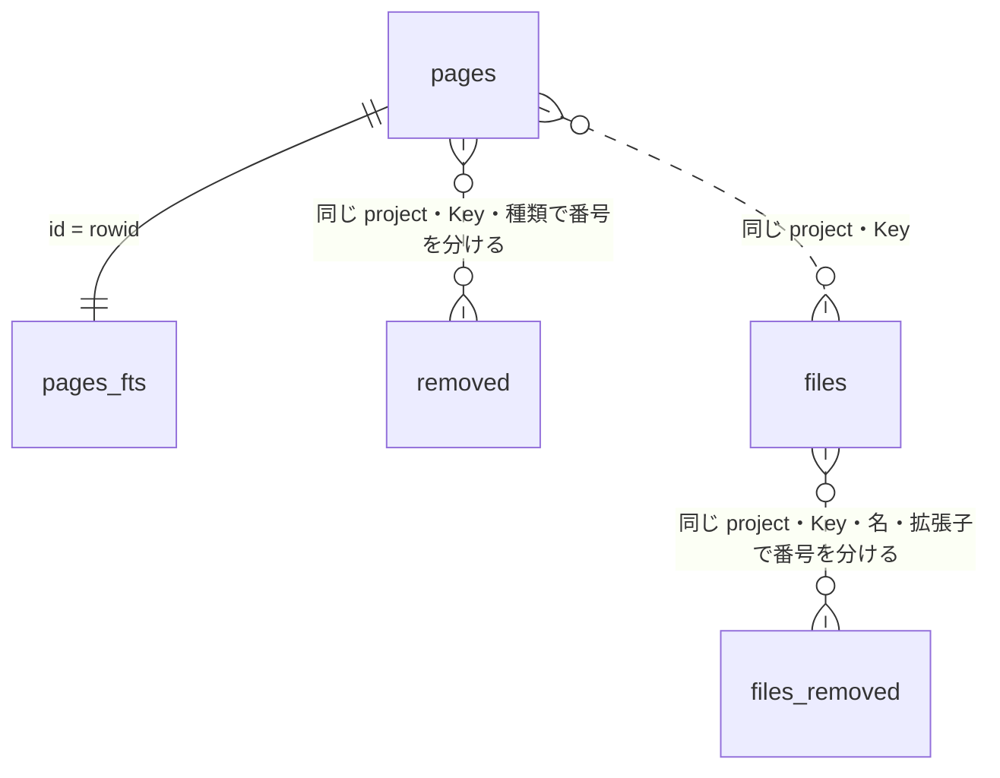

# DB の作り

置き場は、ページと file を SQLite の file 1 つに持つ（置き場所は [動かす](run.md) の表の「DB」）。この章は、その中の表・列・一意と索引と、表どうしの結びを書く。読む人は、SQL を直す人と、[写し](run.md#db-の写しを取る) を `sqlite3` で開いて調べる人。

- **表を作るのは `migrations/` の SQL**: サーバーが起きる時に、まだ当てていない物を当てる。当てた SQL は変えず、次の番号の file を足す（[開発](development.md) の「当てた移行の SQL は変えない」）。SQL の註には古い語が残ることがある（`0001_init.sql` と `0003_files.sql` の `key` の註の「鍵」は、今の語では Key）。
- **この章と本物の DB は、試験が突き合わせる**: `tests/schema_doc.rs` が、移行を当てた DB の表・列・型・空を許すか・主キーと一意と索引を、この章と比べる。表や列を変えたら、同じ PR でこの章も直す。試験が読むので、表ごとの節の形（見出し・列の表・「主キー:」「一意:」「索引:」の行）は崩さない。
- どの表も `strict`（列の型に合わない値は入らない）。時刻はみな UTC の ISO の形の字（`2026-11-21T12:34:56.789Z`）。

## 表どうしの結び

**外部キーは無い。** 表どうしは、同じ値（project・Key など）で結ぶだけで、結びは `src/db.rs` の SQL が守る。

- **番号**: ページの番号は、`pages` と `removed` の両方の、同じ project・Key・種類の番号の最大 ＋ 1。file も同じく、`files` と `files_removed` から取る。だから消した番号は 2 度使わない。書く接続は 1 本なので、番号を取る所は 1 列に並ぶ。
- **消す**: 1 つの取引で、番号を `removed`（file は `files_removed`）に写し、`pages_fts` と `pages`（file は `files`）の行を消す。本文は残さない。
- **ページと file**: ページの本文は file を path（`files/<語>-<n>.<拡張子>`）で参照するだけで、DB の中では結ばない。片方を消しても、もう片方は残る。

## `pages` — ページ

置かれたページ 1 枚が 1 行。置き直すと、別の番号の別の行になる。行を書き換える SQL は無い。

| 列 | 型 | 空 | 意味 |
|---|---|---|---|
| `id` | integer | 不可 | 行の番号。`pages_fts` の `rowid` と同じ |
| `project` | text | 不可 | project の名（URL の 1 段目） |
| `key` | text | 不可 | Key（URL の 2 段目） |
| `kind` | text | 不可 | 種類の名 |
| `n` | integer | 不可 | 番号（project・Key・種類ごとに 1 から） |
| `title` | text | 不可 | 本文の `<title>` から取った題 |
| `role` | text | 不可 | 置いた人の役割（わからなければ `unknown`） |
| `workspace` | text | 不可 | 置いた人の workspace の ID（わからなければ空の字） |
| `created_at` | text | 不可 | 置いた時刻 |
| `body` | blob | 不可 | 本文。置かれた HTML をそのまま |

- 主キー: `(id)`
- 一意: `(project, key, kind, n)`
- 索引: `pages_created` `(created_at)`
- 書く所: `Db::put`。読む所: `Db::body`・`Db::list`・`Db::facets`。消す所: `Db::remove`。

## `pages_fts` — 全文の索引

[全文の索引](glossary.md)（SQLite の FTS5 の仮想の表）。`tokenize='trigram'` で字を 3 字ずつに切るので、日本語の語も引ける。ページ 1 枚が 1 行で、`rowid` が `pages.id`。

| 列 | 型 | 空 | 意味 |
|---|---|---|---|
| `title` | — | 可 | `pages.title` の写し |
| `text` | — | 可 | 本文から tag・script・style を除いた字（`src/text.rs`）。本文そのものは持たない |

- 書く所: `Db::put`（`pages` と同じ取引）。読む所: `Db::list`（探す語が 3 字以上なら索引で引き、短い語があれば端から見る）。消す所: `Db::remove`。
- FTS5 が、中身を持つ影の表（`pages_fts_data`・`pages_fts_idx`・`pages_fts_content`・`pages_fts_docsize`・`pages_fts_config`）を作る。手で触らない。

## `removed` — 消したページの番号

消したページ 1 枚が 1 行。本文は持たない。同じ番号を 2 度使わない（古い URL が別のページを指さない）ためと、消したページの URL に `410` を返すため。

| 列 | 型 | 空 | 意味 |
|---|---|---|---|
| `project` | text | 不可 | 消したページの project |
| `key` | text | 不可 | 消したページの Key |
| `kind` | text | 不可 | 消したページの種類 |
| `n` | integer | 不可 | 消したページの番号 |
| `removed_at` | text | 不可 | 消した時刻 |

- 主キー: `(project, key, kind, n)`
- 書く所: `Db::remove`。読む所: `Db::put`（番号を決める時・取り込みで名指された番号を断る時）・`Db::removed_at`（`410` を返す時）。

## `files` — file

ページから参照する file（画像・PDF・字の file）1 つが 1 行。置き直すと、別の番号の別の行になる。

| 列 | 型 | 空 | 意味 |
|---|---|---|---|
| `id` | integer | 不可 | 行の番号 |
| `project` | text | 不可 | project の名（URL の 1 段目） |
| `key` | text | 不可 | Key（URL の 2 段目） |
| `name` | text | 不可 | 名の語（拡張子と番号を除いた所） |
| `ext` | text | 不可 | 拡張子（受ける物の一覧は `crates/api` が持つ） |
| `n` | integer | 不可 | 番号（project・Key・名・拡張子ごとに 1 から） |
| `type` | text | 不可 | 返す時の `Content-Type`（拡張子から決まる） |
| `size` | integer | 不可 | byte の数 |
| `sha256` | text | 不可 | 中身の SHA-256（16 進の小文字） |
| `role` | text | 不可 | 置いた人の役割（わからなければ `unknown`） |
| `workspace` | text | 不可 | 置いた人の workspace の ID（わからなければ空の字） |
| `created_at` | text | 不可 | 置いた時刻 |
| `body` | blob | 不可 | 中身をそのまま |

- 主キー: `(id)`
- 一意: `(project, key, name, ext, n)`
- 索引: `files_created` `(created_at)`
- 書く所: `Db::put_file`。読む所: `Db::file_body`・`Db::list_files`。消す所: `Db::remove_files`。

## `files_removed` — 消した file の番号

消した file 1 つが 1 行。中身は持たない。`removed` と同じ訳で残す。

| 列 | 型 | 空 | 意味 |
|---|---|---|---|
| `project` | text | 不可 | 消した file の project |
| `key` | text | 不可 | 消した file の Key |
| `name` | text | 不可 | 消した file の名の語 |
| `ext` | text | 不可 | 消した file の拡張子 |
| `n` | integer | 不可 | 消した file の番号 |
| `removed_at` | text | 不可 | 消した時刻 |

- 主キー: `(project, key, name, ext, n)`
- 書く所: `Db::remove_files`。読む所: `Db::put_file`・`Db::file_removed_at`。

## ほかの表

- `_sqlx_migrations`: sqlx が持つ表。当てた移行の番号と、その SQL の SHA-384 を覚えていて、起きる時に `migrations/` の file と突き合わせる。手で触らない。
- `pages_fts_` で始まる表: 上の `pages_fts` の影の表。
