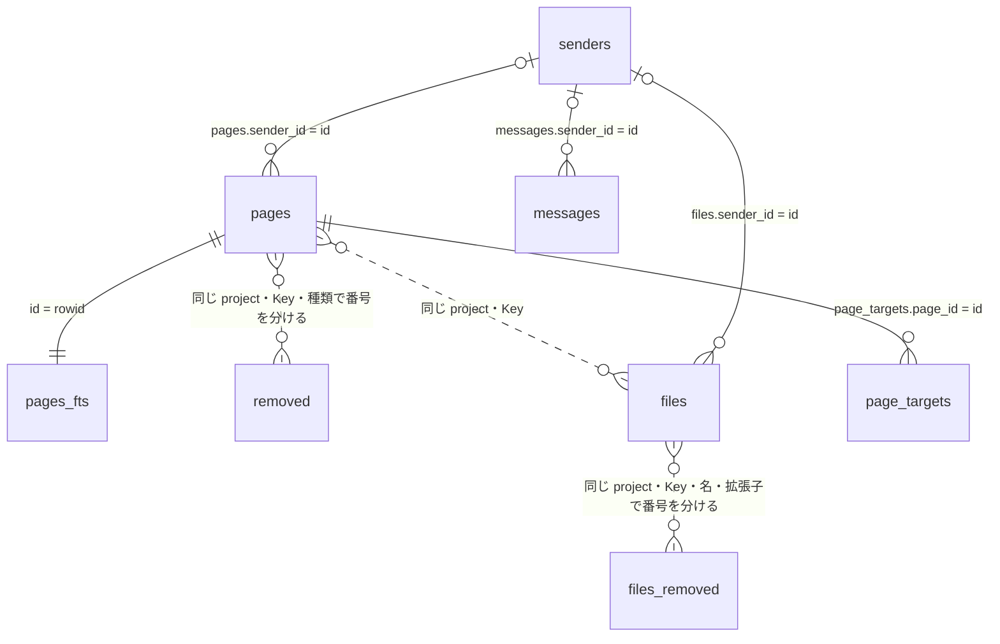

# DB の作り

置き場は、ページと file とメッセージの記録を SQLite の file 1 つに持つ（置き場所は [動かす](run.md) の表の「DB」）。この章は、その中の表・列・一意と索引と、表どうしの結びを書く。読む人は、SQL を直す人と、[写し](run.md#db-の写しを取る) を `sqlite3` で開いて調べる人。

- **表を作るのは `crates/server/migrations/` の SQL**: サーバーが起きる時に、まだ当てていない物を当てる。当てた SQL は変えず、次の番号の file を足す（[開発](development.md) の「当てた移行の SQL は変えない」）。
- **この章と本物の DB は、試験が突き合わせる**: `crates/server/tests/schema_doc.rs` が、移行を当てた DB の表・列・型・空を許すか・主キーと一意と索引を、この章と比べる。表や列を変えたら、同じ PR でこの章も直す。試験が読むので、表ごとの節の形（見出し・列の表・「主キー:」「一意:」「索引:」の行）は崩さない。
- どの表も `strict`（列の型に合わない値は入らない）。時刻はみな UTC の ISO の形の字（`2026-11-21T12:34:56.789Z`）。

## 表どうしの結び

**外部キーは 4 つだけ**: `pages.sender_id` と `files.sender_id` と `messages.sender_id` が `senders.id` を指す（`on delete restrict on update restrict`。ページと file は 0.6.0 から、メッセージの記録は 1.1.0 から）。`page_targets.page_id` が `pages.id` を指す（`on delete cascade on update restrict`。ページを消すと、見た物の行も消える。0.8.0 から）。ほかの表どうしは、同じ値（project・Key など）で結ぶだけで、結びは `crates/server/src/db.rs` の SQL が守る。

- **接続ごとの決まり**: `Db::open` が、読む接続にも書く接続にも `PRAGMA foreign_keys = ON` と `PRAGMA recursive_triggers = ON` を付ける（SQLite では、どちらも接続ごとに効く）。移行を当てた後に `PRAGMA foreign_key_check` を流し、合わない行が 1 つでもあれば、サーバーは起きない。
- **送り手**: ページや file を置く時・メッセージの記録を初めて置く時に、呼ぶ側が付随する id を書けば、`senders` に 1 行足し、その行から指す（同じ取引）。`senders` は足すだけの表で、書き換えも消しも trigger が断る。ページや file を消しても、送り手の行は残る。

- **番号**: ページの番号は、`pages` と `removed` の両方の、同じ project・Key・種類の番号の最大 ＋ 1。file も同じく、`files` と `files_removed` から取る。だから消した番号は 2 度使わない。書く接続は 1 本なので、番号を取る所は 1 列に並ぶ。
- **消す**: 1 つの取引で、番号を `removed`（file は `files_removed`）に写し、`pages_fts` と `pages`（file は `files`）の行を消す。本文は残さない。
- **ページと file**: ページの本文は file を path（`files/<語>-<n>.<拡張子>`）で参照するだけで、DB の中では結ばない。片方を消しても、もう片方は残る。
- **メッセージの記録**: ページとも file とも結ばない（project と Key の値が同じだけ）。消す道は無い。

## `pages` — ページ

置かれたページ 1 枚が 1 行。置き直すと、別の番号の別の行になる。置いた後に書き換わるのは、返事の状態の 3 つの列（`asked_at`・`answered_at`・`waits_on`）と、レビューの判定（`verdict`）だけ。

| 列 | 型 | 空 | 意味 |
|---|---|---|---|
| `id` | integer | 不可 | 行の番号。`pages_fts` の `rowid` と同じ |
| `project` | text | 不可 | project の名（URL の 1 段目） |
| `key` | text | 不可 | Key（URL の 2 段目） |
| `kind` | text | 不可 | 種類の名 |
| `n` | integer | 不可 | 番号（project・Key・種類ごとに 1 から） |
| `title` | text | 不可 | 本文の `<title>` から取った題 |
| `role` | text | 不可 | 置いた人の役割（わからなければ `unknown`） |
| `workspace` | text | 不可 | 置いた人の workspace の ID（わからなければ空の字） |
| `created_at` | text | 不可 | 置いた時刻 |
| `body` | blob | 不可 | 本文。置かれた HTML をそのまま |
| `asked_at` | text | 可 | 返事待ちにした時刻。返事を求めていなければ空（0.5.0 から） |
| `answered_at` | text | 可 | 答えた時刻。まだ答えていなければ空（0.5.0 から） |
| `sender_id` | integer | 可 | 送り手（`senders.id`）。付随する id を書かずに置いたページと、0.6.0 より前に置かれたページは空 |
| `waits_on` | text | 可 | 誰の返事を待つか（`review`・`tpm`）。空は Product Manager（0.8.0 から。前からあるページは空） |
| `verdict` | text | 可 | レビューの判定（`approve`・`concerns`・`reject`・`not-assessed`）。書いていなければ空（0.8.0 から） |

- 主キー: `(id)`
- 一意: `(project, key, kind, n)`
- 索引: `pages_created` `(created_at)`
- 索引: `pages_waiting` `(asked_at)`
- 索引: `pages_sender` `(sender_id)`
- `pages_waiting` は、返事待ち（`asked_at` があり、`answered_at` が空）の行だけの索引。
- 書く所: `Db::put_page`・`Db::set_reply`（返事の状態だけ）・`Db::add_marks`（判定だけ）。読む所: `Db::body`・`Db::list`・`Db::facets`。消す所: `Db::remove`。
- **返事の状態**: `asked_at` も `answered_at` も空なら、返事を求めていないページ。`asked_at` があり `answered_at` が空なら返事待ち。`answered_at` があれば答えた。0.5.0 より前に置かれたページは、どちらも空。誰の返事かは `waits_on` で読み、「返事待ち」「答えた」の数と絞り込み（`on` の無い `reply`）は、`waits_on` が空（Product Manager）の行だけを見る。
- `waits_on`・`verdict` は、SQL の `check` で上の名だけを受ける。

## `pages_fts` — 全文の索引

[全文の索引](glossary.md)（SQLite の FTS5 の仮想の表）。`tokenize='trigram'` で字を 3 字ずつに切るので、日本語の語も引ける。ページ 1 枚が 1 行で、`rowid` が `pages.id`。

| 列 | 型 | 空 | 意味 |
|---|---|---|---|
| `title` | — | 可 | `pages.title` の写し |
| `text` | — | 可 | 本文から tag・script・style を除いた字（`crates/server/src/text.rs`）。本文そのものは持たない |

- 書く所: `Db::put_page`（`pages` と同じ取引）。読む所: `Db::list`（探す語が 3 字以上なら索引で引き、短い語があれば端から見る）。消す所: `Db::remove`。
- FTS5 が、中身を持つ影の表（`pages_fts_data`・`pages_fts_idx`・`pages_fts_content`・`pages_fts_docsize`・`pages_fts_config`）を作る。手で触らない。

## `removed` — 消したページの番号

消したページ 1 枚が 1 行。本文は持たない。同じ番号を 2 度使わない（古い URL が別のページを指さない）ためと、消したページの URL に `410` を返すため。

| 列 | 型 | 空 | 意味 |
|---|---|---|---|
| `project` | text | 不可 | 消したページの project |
| `key` | text | 不可 | 消したページの Key |
| `kind` | text | 不可 | 消したページの種類 |
| `n` | integer | 不可 | 消したページの番号 |
| `removed_at` | text | 不可 | 消した時刻 |

- 主キー: `(project, key, kind, n)`
- 書く所: `Db::remove`。読む所: `Db::put_page`（番号を決める時・取り込みで名指された番号を断る時）・`Db::removed_at`（`410` を返す時）。

## `files` — file

ページから参照する file（画像・PDF・字の file）1 つが 1 行。置き直すと、別の番号の別の行になる。

| 列 | 型 | 空 | 意味 |
|---|---|---|---|
| `id` | integer | 不可 | 行の番号 |
| `project` | text | 不可 | project の名（URL の 1 段目） |
| `key` | text | 不可 | Key（URL の 2 段目） |
| `name` | text | 不可 | 名の語（拡張子と番号を除いた所） |
| `ext` | text | 不可 | 拡張子（受ける物の一覧は `crates/api` が持つ） |
| `n` | integer | 不可 | 番号（project・Key・名・拡張子ごとに 1 から） |
| `type` | text | 不可 | 返す時の `Content-Type`（拡張子から決まる） |
| `size` | integer | 不可 | byte の数 |
| `sha256` | text | 不可 | 中身の SHA-256（16 進の小文字） |
| `role` | text | 不可 | 置いた人の役割（わからなければ `unknown`） |
| `workspace` | text | 不可 | 置いた人の workspace の ID（わからなければ空の字） |
| `created_at` | text | 不可 | 置いた時刻 |
| `body` | blob | 不可 | 中身をそのまま |
| `sender_id` | integer | 可 | 送り手（`senders.id`）。付随する id を書かずに置いた file・一覧の UI から上げた file・0.6.0 より前に置かれた file は空 |

- 主キー: `(id)`
- 一意: `(project, key, name, ext, n)`
- 索引: `files_created` `(created_at)`
- 索引: `files_sender` `(sender_id)`
- 書く所: `Db::put_file`。読む所: `Db::file_body`・`Db::list_files`。消す所: `Db::remove_files`。

## `files_removed` — 消した file の番号

消した file 1 つが 1 行。中身は持たない。`removed` と同じ訳で残す。

| 列 | 型 | 空 | 意味 |
|---|---|---|---|
| `project` | text | 不可 | 消した file の project |
| `key` | text | 不可 | 消した file の Key |
| `name` | text | 不可 | 消した file の名の語 |
| `ext` | text | 不可 | 消した file の拡張子 |
| `n` | integer | 不可 | 消した file の番号 |
| `removed_at` | text | 不可 | 消した時刻 |

- 主キー: `(project, key, name, ext, n)`
- 書く所: `Db::remove_files`。読む所: `Db::put_file`・`Db::file_removed_at`。

## `senders` — 送り手

ページか file を置いた時・メッセージの記録を初めて置いた時の送り手 1 つが 1 行（0.6.0 から）。置く時に、呼ぶ側が付随する id（`actor_issuer`・`actor_ref`）を書けば、置くたびに 1 行足す。置き場に castlist の URL（[動かす](run.md) の表の「設定」）があれば、その時に castlist に聞いた答え（アクターの id・名・種類）も残す。

| 列 | 型 | 空 | 意味 |
|---|---|---|---|
| `id` | integer | 不可 | 行の番号。`pages.sender_id`・`files.sender_id`・`messages.sender_id` が指す |
| `actor_issuer` | text | 不可 | 付随する id を出した物（`tpm` など） |
| `actor_ref` | text | 不可 | 付随する id（`<種類>:<値>`。`claude.session:…` など） |
| `actor_id` | text | 可 | castlist のアクターの id。castlist に聞かなかった（置き場に castlist の URL が無かった）時は空 |
| `actor_name` | text | 可 | castlist のアクターの名（その時の物）。聞かなかった時は空 |
| `actor_kind` | text | 可 | castlist のアクターの種類（`ai`・`human`）。聞かなかった時は空 |
| `resolved_at` | text | 可 | castlist が答えた時刻（答えの `as_of`）。聞かなかった時は空 |
| `created_at` | text | 不可 | 行を足した時刻 |

- 主キー: `(id)`
- 索引: `senders_actor` `(actor_id)`
- 書く所: `Db::put_page`・`Db::put_file`・`Db::put_message`（ページ・file・メッセージの記録と同じ取引）。読む所: `Db::list`・`Db::list_files`・`Db::list_messages`・`Db::set_reply`（記録に添える）・`Db::facets`（絞り込みの候補）。
- **足すだけ**: trigger `senders_no_update`・`senders_no_delete` が、書き換えと消しを `append-only: senders` で断る。前からある表（`pages`・`files` など）には trigger を付けていない（返事の状態の書き換え・消すは前のまま）。
- **聞けた・聞かなかった**: `actor_id`・`actor_name`・`actor_kind`・`resolved_at` が空の行は、castlist に聞かなかった送り手（画面では「未確認」）。castlist に聞けなかった時・castlist が知らない送り手の時は、ページも file も送り手の行も、何も残さない（[API の仕様](api.md) の「送り手」）。
- `actor_id` に外部キーは無い（アクターは castlist の DB にある）。

## `page_targets` — 見た物

ページが見た物（レビューのページ）・見てほしい物（レビューの依頼書）1 つが 1 行（0.8.0 から）。依頼書 1 枚が頼みをいくつも持つので、1 枚に何行でもある。

| 列 | 型 | 空 | 意味 |
|---|---|---|---|
| `page_id` | integer | 不可 | 見たページ（`pages.id`） |
| `target` | text | 不可 | 見た物: この置き場のページの path（`/<project>/<key>/<kind>-<n>.html`）か、`https://` の URL（PR など） |

- 主キー: `(page_id, target)`
- 索引: `page_targets_target` `(target)`
- 書く所: `Db::add_marks`（足すだけ。同じ物は 1 つ）。読む所: `Db::list`（記録の `targets`。足した順）・`Db::reviews_of`（見られたページの側から、そのページを見たレビューを引く。一覧の UI の「レビュー:」）。消す所: ページを消すと、外部キーの `on delete cascade` で一緒に消える。
- 見られたページを消しても、その path を見た物に持つ行は残る（一覧の UI の「見た物:」の link は、消したページの `410` を開く）。消すのは TPM 担当だけで数も少ないので、そのままにしている。

## `messages` — メッセージの記録

ほかの道具（roster）が配ったメッセージ 1 通の記録が 1 行（1.1.0 から）。「誰が誰に何を送り、いつ届いたか」を、呼ぶ側が書いたとおりに持つ。置き場は見せるだけで、配らず、状態を自分で決めず、期限を持たない。同じ project と id にもう 1 度置くと、別の行にならず、同じ行に書き足す。

| 列 | 型 | 空 | 意味 |
|---|---|---|---|
| `id` | integer | 不可 | 行の番号（一覧の頁の続きに使う） |
| `project` | text | 不可 | project の名（ページの project と同じ） |
| `message_id` | text | 不可 | メッセージの id（呼ぶ側が付ける。API の `id`） |
| `key` | text | 可 | Key。書かずに置けば空 |
| `heading` | text | 不可 | メッセージの見出しの名 |
| `from_name` | text | 不可 | 送り手の名（API の `from`） |
| `to_name` | text | 不可 | 受け手の名（API の `to`） |
| `text` | text | 不可 | 本文。字のまま（HTML として解釈しない） |
| `sent_at` | text | 不可 | 送った時刻（呼ぶ側が書いた物） |
| `state` | text | 不可 | 状態（`waiting`・`delivered`・`undeliverable`・`expired`・`carried`） |
| `delivered_at` | text | 可 | 届いた時刻（呼ぶ側が書いた物。初めに書かれた時刻を保つ）。まだ無ければ空 |
| `via` | text | 可 | どの時に渡したかの名。書いていなければ空 |
| `deliveries` | integer | 可 | 渡した回数。書いていなければ空 |
| `reply_to` | text | 可 | 返事の先のメッセージの id（外部キーは無い。先の記録が無くてもよい）。書かずに置けば空 |
| `created_at` | text | 不可 | 置き場が初めて受けた時刻 |
| `updated_at` | text | 不可 | 最後に書き足された時刻（置いただけなら `created_at` と同じ） |
| `sender_id` | integer | 可 | 送り手（`senders.id`）。初めに置いた時に付随する id を書かなければ空 |

- 主キー: `(id)`
- 一意: `(project, message_id)`
- 索引: `messages_sent` `(sent_at)`
- 書く所: `Db::put_message`（置く・書き足す）。読む所: `Db::list_messages`・`Db::message_facets`（一覧の UI の絞り込みの候補と「まだ届いていない n 件」）。消す所は無い。
- **書き足しで替わる列**: `state`（新しい値）・`via`・`deliveries`（書けば新しい値。書かなければ前のまま）・`delivered_at`（空の時だけ入る）・`updated_at`。ほかの列と `sender_id` は、初めに置いた値のまま（[API の仕様](api.md) の「メッセージの記録」）。
- `state` は、SQL の `check` で上の名だけを受ける。

## ほかの表

- `_sqlx_migrations`: sqlx が持つ表。当てた移行の番号と、その SQL の SHA-384 を覚えていて、起きる時に `crates/server/migrations/` の file と突き合わせる（合わなければ、移行を当てずに断る。後の版が書いた DB など。[API の仕様](api.md) の「データ」）。手で触らない。
- `pages_fts_` で始まる表: 上の `pages_fts` の影の表。
