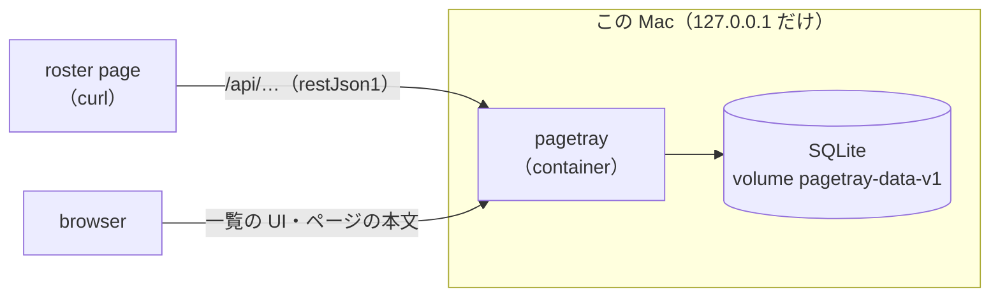

# pagetray

ページ（HTML）の置き場のサーバー。置かれたページを DB（SQLite）に持ち、番号を付け、絞って探せる一覧の UI を出す。
この Mac の中（`127.0.0.1`）だけで使う物で、`roster page` の命令（[roster](https://github.com/uraitakahito/roster)）が、ここの API を `curl` で呼ぶ。

## この本の章

| 章 | 中身 |
|---|---|
| [動かす](run.md) | 起こす・確かめる・DB の写しを取る・写しから戻す・止める・版を上げる |
| [CLI](cli.md) | 置き場を端末から操作する命令の入れ方と一覧 |
| [API の仕様](api.md) | 呼ぶ側が頼ってよい形（操作・誤り・守りの層） |
| [release を出す](release.md) | image を出す手順と、image に入ってよい物 |
| [開発](development.md) | source の作り・試験・この本の直し方 |
| [DB の作り](db.md) | 表・列・一意と索引と、表どうしの結び |
| [用語集](glossary.md) | 文書・画面・code で使う語と、使わない言い方 |

## API の早見

呼ぶ側が頼ってよい形は [API の仕様](api.md)。ここは早見。API は Smithy の定義から作り、protocol は restJson1（欄の名は camelCase、誤りは header `X-Amzn-Errortype` と本文の `message`）。

| 道 | 中身 |
|---|---|
| `POST /api/projects/<project>/keys/<key>/kinds/<kind>/pages?role=&workspace=` | ページを置く（`CreatePage`）。本文は HTML。番号を決めて `201` と JSON を返す。`n`・`createdAt` は取り込みの時だけ付け、番号が使われていれば `409` |
| `GET /api/pages` | ページを探す（`ListPages`）。`project`・`key`・`kind`・`role`・`workspace`・`q`・`reply`・`on`・`verdict`・`actor`・`sort` で絞る。`maxResults` と `nextToken` で頁を送る。`{"pages":[…]}` |
| `PUT /api/projects/<project>/keys/<key>/kinds/<kind>/pages/<n>/reply` | 返事の状態を書く（`SetReplyState`） |
| `POST /api/projects/<project>/keys/<key>/kinds/<kind>/pages/<n>/review` | レビューの印を書く（`AddReviewMarks`） |
| `DELETE /api/pages?project=[&key=][&kind=][&n=]` | 合うページを消し（`DeletePages`）、番号を表 `removed` に残して、消した path の一覧を返す。`n` には `key` と `kind` が要る。人は見分けない（だれが消してよいかは、呼ぶ側が決める） |
| `GET /<project>/<key>/<kind>-<n>.html` | 本文。無ければ `404`、消したページは `410` |
| `POST /api/projects/<project>/keys/<key>/files?name=&role=&workspace=` | file を置く（`CreateFile`）。本文は file の中身（`Content-Type` が要る）。`name` は `<語>.<拡張子>` で、番号を決めて `201` と JSON を返す。受けない種類は `415`、16 MiB を超えれば `413` |
| `GET /api/files` | file を探す（`ListFiles`）。`project`・`key`・`role`・`workspace`・`q`・`actor`・`sort` で絞る。`{"files":[…]}` |
| `DELETE /api/files?project=[&key=][&name=][&n=]` | 合う file を消し（`DeleteFiles`）、番号を表 `files_removed` に残して、消した path の一覧を返す。人は見分けない |
| `GET /<project>/<key>/files/<語>-<n>.<拡張子>` | file の中身。無ければ `404`、消した file は `410` |
| `PUT /api/projects/<project>/messages/<id>` | メッセージの記録を置く・書き足す（`PutMessage`）。本文は JSON。初めての id は `201`、もうある id は書き足して `200`。置き場は見せるだけ（配らない・状態を決めない） |
| `GET /api/messages` | メッセージの記録を探す（`ListMessages`）。`project`・`key`・`to`・`from`・`state`・`heading`・`q`・`sort` で絞る。`{"messages":[…]}` |
| `GET /`・`/<project>/`・`/<project>/<key>/` | 一覧の UI（絞った一覧） |
| `GET /messages` | メッセージの一覧（メッセージの記録を見る画面） |
| `GET /api/events` | 置かれるたび・書かれるたびに 1 件を push（SSE。file は `event: file`、返事は `event: reply`、印は `event: review`、メッセージの記録は `event: message-record`） |
| `GET /api/backup` | DB の写し |
| `GET /api/logs` | 残した記録 |
| `GET /healthz` | 生きているかと、サーバーの版（`{"status":"ok","version":"<version>"}`） |

- **この Mac の中からだけ**: `Host` が `127.0.0.1`・`localhost` でない要求と、`Origin` の付いた書く要求は断る。例外は、一覧の UI が同じ `Origin` から file を上げる `POST /api/projects/<project>/keys/<key>/files` だけ（役割は `product-manager` で記録する。[API の仕様](api.md) の「守りの層」）。
- **種類と役割の名**: 一覧は持たない。字の形（英小文字で始まり、英小文字・数字・`-` で 32 字まで）だけを見る。
- **一覧の UI**: サーバーが HTML を組んで返す。絞り込み・並べ替え・検索は link と form で、条件は URL に出る（script が無くても動く）。script がするのは、ページが置かれた時と、返事の状態・レビューの印が書かれた時に、一覧の列と絞り込みの列をサーバーが組んだ HTML に差し替えること（本文の枠は読み込み直さない）と、新着の印・未読の印（browser が覚える）・時刻をこの Mac の時刻で出すことと、file を上げることだけ。画面は 4 つの区画（操作の帯・絞り込みの列・一覧の列・本文の枠）でできていて、選んだページは、本文の枠（`sandbox` を付けた iframe）に 1 枚だけ出す。Key の画面（project と Key を 1 つずつ選んだ時）には、file の枠と上げる枠が足される（[動かす](run.md) の「一覧の UI から file を上げる」）。語の意味は [用語集](glossary.md)。
- **番号**: 書く接続は 1 本で、1 つの SQL が「今の最大 ＋ 1」を取って足す。最大は、置いてあるページ（`pages`）と消したページ（`removed`）の両方から取るので、消した番号は 2 度使わない（古い URL が別のページを指さない）。取り込みで消した番号を名指すと `409`。置いたページを書き換えるエンドポイントは無い。
- **消す**: 1 つの取引で、`removed` に番号を写し、`pages_fts` と `pages` の行を消す。本文は残さない（戻せない）。
