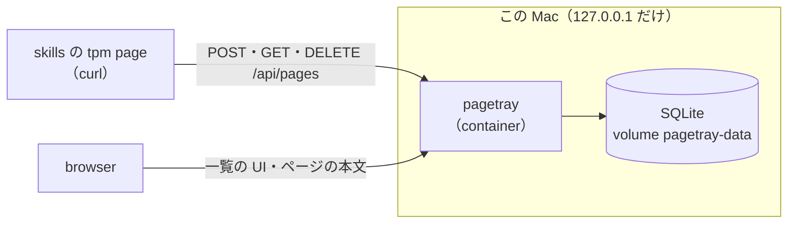

# pagetray

ページ（HTML）の置き場のサーバー。置かれたページを DB（SQLite）に持ち、番号を付け、絞って探せる一覧の UI を出す。
この Mac の中（`127.0.0.1`）だけで使う物で、[skills](https://github.com/uraitakahito/skills) の `tpm page` の命令が、ここの口を `curl` で呼ぶ。

もとは skills の repo の `pagestore/` にあった物を、履歴ごと分けた。版ごとに変えたことは [CHANGELOG.md](https://github.com/uraitakahito/pagetray/blob/main/CHANGELOG.md)。

## この本の章

| 章 | 中身 |
|---|---|
| [動かす](run.md) | 起こす・確かめる・DB の写しを取る・写しから戻す・止める・版を上げる |
| [口の約束](api.md) | 呼ぶ側が頼ってよい形と、口の版の決まり |
| [release を出す](release.md) | image を出す手順と、image に入ってよい物 |
| [開発](development.md) | source の作り・試験・この本の直し方 |

## 口の早見

呼ぶ側が頼ってよい形と、口の版の決まりは [口の約束](api.md)。ここは早見。

| 口 | 中身 |
|---|---|
| `POST /api/pages?project=&key=&kind=&role=&workspace=` | 本文は HTML。番号を決めて `201` と JSON を返す。`n`・`created_at` は取り込みの時だけ付け、番号が使われていれば `409` |
| `GET /api/pages` | `project`・`key`・`kind`・`role`・`workspace`・`q`・`sort`・`limit`・`before`・`after` で絞る。`{"pages":[…]}` |
| `DELETE /api/pages?project=[&key=][&kind=][&n=]` | 合うページを消し、番号を表 `removed` に残して、消した path の一覧を返す。`n` には `key` と `kind` が要る。人は見分けない（だれが消してよいかは、呼ぶ側が決める） |
| `GET /<project>/<key>/<kind>-<n>.html` | 本文。無ければ `404`、消したページは `410` |
| `GET /`・`/<project>/`・`/<project>/<key>/` | 一覧の UI（絞った一覧） |
| `GET /api/events` | 置かれるたびに 1 件を push（SSE） |
| `GET /api/backup` | DB の写し |
| `GET /api/version` | サーバーの版と口の版（`{"version":"0.2.0","api":1}`）。どの答えにも header `Pagetray-Api` が付く |
| `GET /healthz` | 生きているか |

- **この Mac の中からだけ**: `Host` が `127.0.0.1`・`localhost` でない要求と、`Origin` の付いた書く要求は断る。
- **種類と役割の名**: 一覧は持たない。字の形（英小文字で始まり、英小文字・数字・`-` で 32 字まで）だけを見る。
- **一覧の UI**: サーバーが HTML を組んで返す。絞り込み・並べ替え・検索は link と form で、条件は URL に出る（script が無くても動く）。script がするのは、新着の印・未読の印（browser が覚える）・時刻をこの Mac の時刻で出すことだけ。選んだページは、右の枠（`sandbox` を付けた iframe）に 1 枚だけ出す。
- **番号**: 書く接続は 1 本で、1 つの SQL が「今の最大 ＋ 1」を取って足す。最大は、置いてあるページ（`pages`）と消したページ（`removed`）の両方から取るので、消した番号は 2 度使わない（古い URL が別のページを指さない）。取り込みで消した番号を名指すと `409`。置いたページを書き換える口は無い。
- **消す**: 1 つの取引で、`removed` に番号を写し、`pages_fts` と `pages` の行を消す。本文は残さない（戻せない）。
